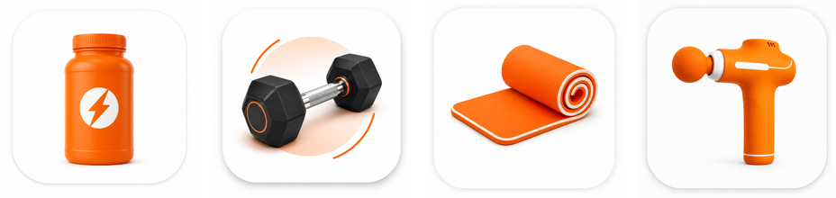

<h1 align="center">FitShop</h1>
<p align="center"><b>A fitness e-commerce iOS app built with SwiftUI and Firebase</b></p>

<p align="center">
  
</p>

<p align="center">
  
  
  
</p>

---

FitShop is a shopping app for fitness products: supplements, equipment, accessories, and electronics. Users browse a catalog loaded from a JSON API, filter by category, search, and manage a live cart synced with Cloud Firestore. They can check out, view their order history, and keep a profile with a photo from the camera or gallery. Guests can browse and build a cart before creating an account.

Team project for the Advanced Mobile Application Development course at the Higher Colleges of Technology (HCT), Abu Dhabi.

## Features

| Area | What it does |
|------|--------------|
| **Authentication** | Email/password sign-up and login with Firebase Auth, with validation (email format, password length and confirmation). Guest mode lets people browse without an account. |
| **Catalog** | Loads products from a REST/JSON endpoint with `URLSession` and `Codable`, shows them in a 2-column grid with async images, and filters by category. |
| **Search** | Finds products by name or category. |
| **Product details** | Image, price in AED, description, and Add to Cart. Adding an item already in the cart increases its quantity instead. |
| **Live cart** | Firestore snapshot listener keeps the cart in sync in real time. Change quantities, swipe to delete with confirmation, see the running total, and a badge on the tab. |
| **Checkout** | Delivery form, card-format validation (16-digit card, 3-digit CVV, future expiry), and an order summary. The order is saved to Firestore and the cart is cleared. |
| **Order history** | Each user's past orders with an itemized receipt, newest first. |
| **Profile** | View and edit profile details, take or pick a profile photo (UIKit camera/gallery bridge), and save it to Firestore. |
| **Settings** | Dark mode toggle saved with `@AppStorage`. |

> Checkout is a demo: card details are only validated on the device. They are never stored or charged.

## Tech stack

- **SwiftUI**: `TabView`, `NavigationStack`, `LazyVGrid`, sheets, alerts, swipe actions, badges
- **Firebase Auth**: email/password authentication and session handling
- **Cloud Firestore**: CRUD, `Codable` models with `@DocumentID`, queries, real-time snapshot listeners
- **URLSession + Codable**: fetching and decoding the product catalog
- **UIKit interop**: `UIViewControllerRepresentable` wrapping `UIImagePickerController`
- **AppStorage**: appearance preference

## Firestore data model

| Collection | Contents |
|------------|----------|
| `users` | One document per user: email, name, city |
| `ProfilesColl` | Full profile, including the photo saved as Base64 |
| `CartCollection` | Cart items (product, quantity, `userID`) |
| `OrdersCollection` | Orders with delivery info, total, and line items |

## Project structure

```
Project/
├── FitShopApp.swift, ContentView.swift          # App entry, auth gate, tab bar
├── LoginView, SignUpView                        # Authentication
├── ProductListView, ProductDetailView,
│   SearchProductView, ProductRowView            # Catalog & search
├── CartView, CheckoutView, OrderHistoryView     # Cart & orders
├── ProfileView, EditProfileView, SettingsView,
│   CameraManager                                # Profile & settings
├── Product, CartItem, Profile                   # Models
└── Assets.xcassets/                             # Category artwork
```

## Getting started

Requirements: **Xcode 26** or later. Firebase is added through Swift Package Manager and resolves automatically.

1. Clone the repo and open `Project.xcodeproj`.
2. Create a project in the [Firebase console](https://console.firebase.google.com/) and add an **iOS app** with bundle ID `CIS.Project`.
3. Download `GoogleService-Info.plist` and put it in the `Project/` folder. (`GoogleService-Info.plist.example` shows the expected format. The real file is git-ignored.)
4. In Firebase, turn on **Authentication → Email/Password** and create a **Cloud Firestore** database.
5. Choose an iPhone simulator and press **Run** (⌘R).

## Possible improvements

- Per-user Firestore security rules, with anonymous auth for guest carts
- Store profile photos in Firebase Storage instead of Base64 in Firestore
- Integrate a real payment provider (for example Apple Pay or Stripe test mode)
- Host the product catalog in Firestore so it can be managed from an admin view

## Team

Built as a team project at HCT. Contributor: **Abdulrahman Alkatheeri**.
